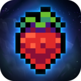
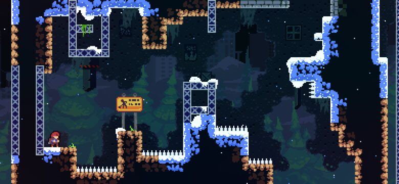
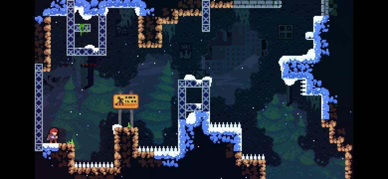
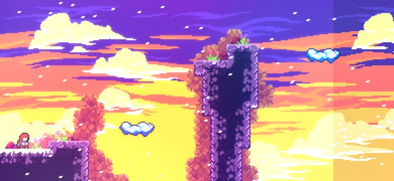
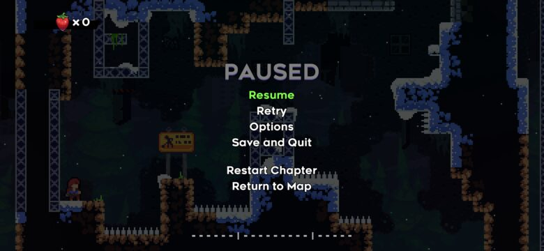

<div align="center">



# CelesteAndroid

**Celeste (2018) running natively on Android, from your own PC copy.**

Pick your game files once and play: .NET on ARM64, FNA + SDL3, Vulkan or OpenGL ES, FMOD audio,<br>
on-screen touch controls and a widescreen mode that fills your phone's display. No emulation, no browser.

<a href="../../releases/latest"></a>


<a href="LICENSE"></a>

<a href="../../releases/latest"></a>
<a href="#%EF%B8%8F-how-it-works"></a>
<a href="docs/BUILDING.md"></a>
<a href="../../releases"></a>
<a href="https://www.youtube.com/@belmante"></a>

</div>

---

> [!IMPORTANT]
> **No game files are included.** This project doesn't contain Celeste or any of its assets. You need a legally owned copy of Celeste for PC (the **FNA build**, see below). The app imports it from your device, the same model PortMaster and other community ports use.

## 📸 Screenshots

<div align="center">

| Widescreen (19.5:9) | Before (16:9 with side bars) |
|:---:|:---:|
|  |  |
|  |  |

More in [docs/WIDESCREEN.md](docs/WIDESCREEN.md).

</div>

## ✨ Features

| | |
|---|---|
| 🚀 **Native** | The game runs on .NET for ARM64, with FNA, FNA3D and SDL3 built for Android. Vulkan by default (SDL_GPU), OpenGL ES as a fallback. |
| 🔊 **Full audio** | FMOD Studio 1.10.14, the version the game's sound banks were built with. |
| 🖥️ **Widescreen** | The game takes your screen's aspect ratio (19.5:9, 20:9, 21:9…): more of the level on the sides, no black bars. Menus and dialogue stay centred. Can be turned off. |
| 🎮 **Touch controls** | Stick + grab / dash / jump / journal / retry, an always-visible pause button and a keyboard button. They fade when idle, work alongside a controller, and an editor lets you drag and resize each control (left-handed mode included). |
| 📦 **Simple launcher** | Select your game files once, tap **Play**, and from then on the app opens straight into the game. |
| 💾 **Your saves** | Import your PC saves and export them back to the PC whenever you want. |
| 🔒 **Your files stay yours** | The original `Celeste.exe` is never modified. A patched copy is made on the device with [MonoMod](https://github.com/MonoMod/MonoMod), the tooling the [Everest](https://everestapi.github.io/) mod loader uses. |

## 📋 Requirements

| | |
|---|---|
| **Device** | Android 8.0+ (API 26), **ARM64** (arm64-v8a) |
| **Storage** | ~1.2 GB free (the game's `Content` folder is ~1.1 GB) |
| **Game** | **Celeste for PC, FNA build**, version 1.4.0.0 |
| **Input** | On-screen touch controls, or a controller (Bluetooth/USB), or a keyboard |

### Which version of Celeste?

You need the **FNA build** of the PC version. Its folder has `Celeste.exe`, **`FNA.dll`** and `Content/`.

- **Steam**: Library → right-click Celeste → *Properties* → *Betas* → pick **`fna`**. After the update, copy the whole game folder (*Manage → Browse local files*). The default Steam build on Windows uses XNA and **won't work** (there's no `FNA.dll`).
- **itch.io**: the **Linux `.zip`** already is the FNA build, and you can import the `.zip` directly.

## 📲 Installing

1. Download the APK from [**Releases**](../../releases/latest) and install it.
2. Copy your Celeste folder (or the itch.io `.zip`) to your phone, for example to `Download/`.
3. Open **Celeste**, tap **Select game files** (or *import a .zip*) and pick it.
4. Wait for the import (copy + patch, 1–2 minutes) and tap **Play**.

From then on, opening the app starts the game directly. **Settings** (graphics, touch controls and layout, widescreen, saves, game files) are one long-press away: long-press the app icon → *Settings*.

> [!NOTE]
> Your saves live in the app's private storage, and **uninstalling the app deletes them**. Use *Settings → Export saves* to keep a copy (the files go straight into the `Saves` folder of the PC game), and *Import saves* to bring your PC progress over. Android's cloud backup keeps the saves and the settings, never the ~1.1 GB of game files.

Updating the app doesn't require importing again: if the new APK ships a newer patch, the game is re-patched on first open (a few seconds) and starts right after.

## ⚙️ How it works

```
App (launcher)                    Game process (":game")
 ├─ import folder / .zip           ├─ SDLActivity (SDL3 Java) → GameActivity.Main() on the SDL thread
 ├─ MonoMod: Celeste.exe  ──►      ├─ loads the patched Celeste.dll and calls Celeste.Main()
 │   → patched Celeste.dll         ├─ FNA (C#) → FNA3D (Vulkan/GLES) + SDL3
 └─ widescreen IL pass             └─ FMOD 1.10.14 (Java + .so)
```

The patches are small and focused: a Steamworks stub, SDL2 → SDL3 shims, `GetEntryAssembly` fixes, an Android GC fallback, the touch controls and the widescreen pass (the game's resolution is baked in as constants, so a Cecil pass rewrites each use site to the screen's width). The full story is in [docs/ARCHITECTURE.md](docs/ARCHITECTURE.md) and [docs/WIDESCREEN.md](docs/WIDESCREEN.md).

## 🛠️ Building from source

See [docs/BUILDING.md](docs/BUILDING.md). Short version (Windows; the same `dotnet` steps work on Linux):

```powershell
git clone --recursive https://github.com/BelmanteGu/CelesteAndroid
cd CelesteAndroid
# 1. Your Celeste (FNA build) in .\Celeste\ and the FMOD 1.10.14 Android libs in .\fmod\libs\android-arm64\
scripts\build-natives-android.ps1      # 2. SDL3, FNA3D, FAudio for arm64 (Android NDK)
scripts\build-release.ps1              # 3. -> out\CelesteAndroid-<version>.apk
```

| Script | What it does |
|---|---|
| `scripts/build-natives-android.ps1` | Builds SDL3, FNA3D and FAudio for Android (NDK r27) |
| `scripts/build-release.ps1` | Release APK. `-Personal` adds art taken from *your* game files; `-EmbedGame` puts your game inside the APK. **Personal APKs must never be shared.** |
| `scripts/deploy-android.ps1` | Development loop: patch, install the APK and push files over `adb` |
| `scripts/fetch-fnalibs.ps1` | Downloads the x64 fnalibs for the desktop test host |
| `scripts/generate-game-art.ps1` | Extracts the icon/key art from your game files (for personal builds) |

The desktop test host (`src/Celeste.Desktop`) runs the same patched game on Windows and Linux, with environment variables to jump into a chapter and take screenshots (see [docs/WIDESCREEN.md](docs/WIDESCREEN.md)).

## 📊 Status

| | |
|:---:|---|
| ✅ | Plays with a controller or touch (Galaxy S23, Snapdragon 8 Gen 2, Android 16) |
| ✅ | Vulkan and OpenGL ES, 60 FPS, FMOD audio, pause/resume |
| ✅ | Widescreen in every chapter (see the [known limitations](docs/WIDESCREEN.md)) |
| ✅ | On-screen touch controls with a layout editor; device keyboard for typing |
| ✅ | Import from a folder or `.zip`, patching on the device |
| ✅ | Import and export of `.celeste` saves |
| 🚧 | Everest / mods |

Tested on one device so far. Reports from other phones (especially Mali/Exynos/Tensor GPUs) are very welcome. Open an [issue](../../issues).

## ⚖️ Legal

- Celeste © Maddy Makes Games Inc. This project is **not affiliated with or endorsed by** Maddy Makes Games, Extremely OK Games or Firelight Technologies.
- This repository contains **no** game code or assets. The game is loaded from the user's own copy at runtime.
- The released APK's launcher shows Celeste artwork (the logo and an animated Madeline background, © Maddy Makes Games) and a pixel-art strawberry icon, as fan ports commonly do. That artwork isn't in this repository; builds from source use the imported game's key art unless you provide your own.
- **FMOD**: the released APK includes the FMOD Studio 1.10.14 runtime libraries. *FMOD Studio by Firelight Technologies Pty Ltd.* FMOD isn't open source and is **not** covered by this project's MIT license. See [THIRD_PARTY_NOTICES.md](THIRD_PARTY_NOTICES.md).

## 💜 Credits

- [FNA](https://fna-xna.github.io/), FNA3D and FAudio by Ethan Lee (flibitijibibo) and contributors
- [SDL](https://libsdl.org/), [MonoMod](https://github.com/MonoMod/MonoMod) and [Mono.Cecil](https://github.com/jbevain/cecil)
- [Pixelify Sans](https://github.com/eifetx/Pixelify-Sans) (launcher font, OFL)
- Touch controls by [@Gdpro835](https://github.com/Gdpro835)
- Prior art and inspiration: [Everest](https://github.com/EverestAPI/Everest), [celeste-wasm](https://github.com/MercuryWorkshop/celeste-wasm), [FNADroid](https://github.com/0x0ade/FNADroid) and JohnnyonFlame's [FNAPatches](https://github.com/JohnnyonFlame/FNAPatches)
- And of course, Celeste by Maddy Thorson, Noel Berry and the whole team. Go buy it if you haven't.

<div align="center">

**Made by [Projeto Belmante](https://www.youtube.com/@belmante)** · MIT License · Third-party components keep their own licenses ([THIRD_PARTY_NOTICES.md](THIRD_PARTY_NOTICES.md))

</div>
