# Widescreen

O Celeste foi feito para 16:9 (320×180 de pixel art, ampliado para 1920×1080). Celulares são mais largos (19.5:9, 20:9…), então o original fica com faixas nas laterais. Com o widescreen ligado (padrão; "Wide: On/Off" no launcher), o jogo ocupa a tela toda e a câmera mostra mais cenário dos lados.

| Antes (16:9) | Widescreen (19.5:9) |
|---|---|
| 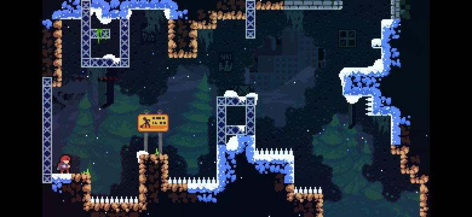 | 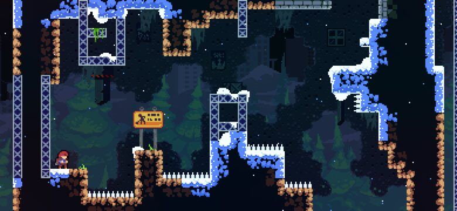 |

## Como funciona

A resolução está embutida no jogo como constante (`Celeste.GameWidth = 320`, `TargetWidth = 1920`), e o compilador copia o número para cada lugar que o usa. Não dá para mudar uma variável: é preciso trocar cada uso.

- **`src/Celeste.Patcher/WidescreenPass.cs`**: depois do MonoMod, um passo com Cecil troca as constantes por chamadas a `CelesteAndroid.Wide` (`src/Celeste.Android.Patches/Wide/Wide.cs`), que devolve a largura da tela em uso (390 pixels de jogo em 19.5:9, por exemplo). Com o modo desligado ou numa tela 16:9, os valores são os originais e o jogo fica idêntico.
- **`src/Celeste.Patcher/WidescreenRules.cs`**: a lista de onde trocar, método por método. 320 e 160 também são velocidades no código do jogo (Player, Puffer…), então cada entrada foi conferida no contexto.
- **Interface**: menus, textos e HUD continuam no layout 1920×1080, centralizados na tela (deslocamento em `Engine.ScreenMatrix`, ver `patch_Engine.UpdateView`). Só os fundos de tela cheia (escurecer no pause, fades) são esticados até as bordas (`patch_Draw.Rect`). Assim nenhum menu fica preso à esquerda.
- **Salas estreitas**: uma sala mais estreita que a tela fica centralizada (`patch_Player.CameraTarget`); dos lados aparece o que existe em volta dela no mapa.

## Testando no PC

O host desktop roda no Linux e no Windows. As variáveis de ambiente do `DevTools` (`src/Celeste.Android.Patches/DevTools.cs`) permitem testar sem jogar até a tela que interessa:

```sh
CELESTE_DEV_WINDOW=1560x720   # janela na proporção do celular (também define a proporção do widescreen)
CELESTE_DEV_LEVEL=4           # entra direto no capítulo 4 (4:b para o lado B)
CELESTE_DEV_PAUSE=2000        # abre o menu de pausa no quadro 2000
CELESTE_DEV_SHOTS=/tmp/shots CELESTE_DEV_SHOT_FRAMES=1900,2400   # salva screenshots
CELESTE_DEV_EXIT_FRAME=2450   # fecha o jogo
```

## Capturas (19.5:9)

| | |
|---|---|
| 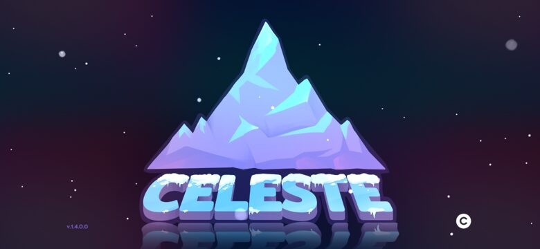 | 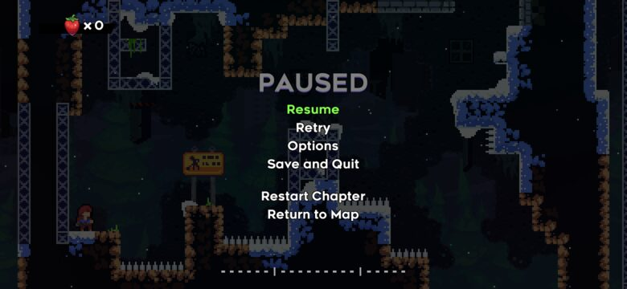 |
| 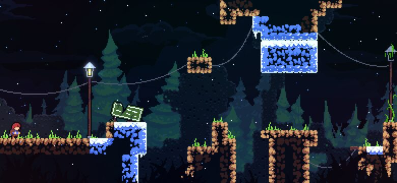 | 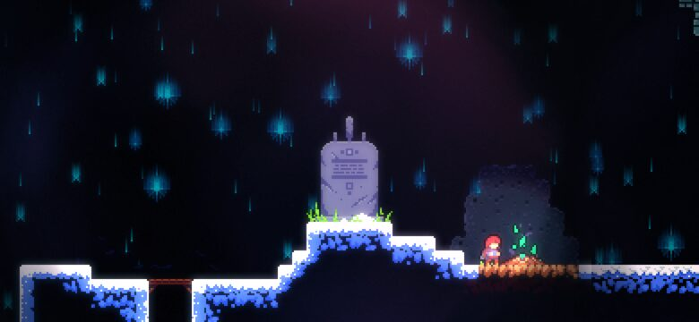 |
| 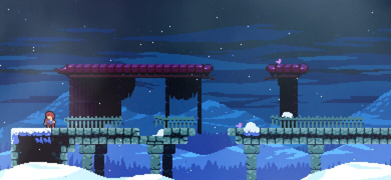 | 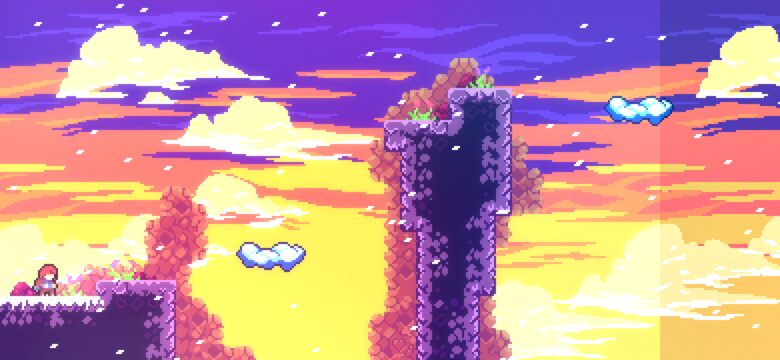 |
| 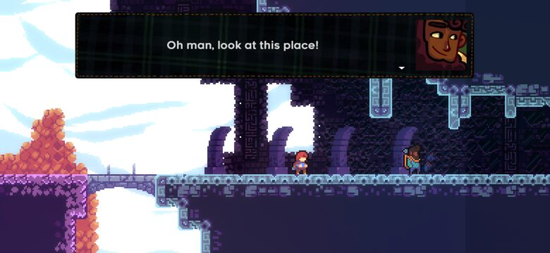 | 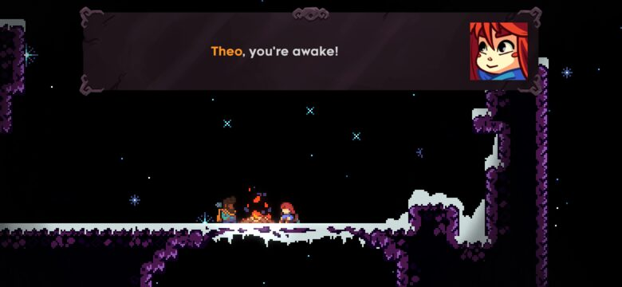 |
| 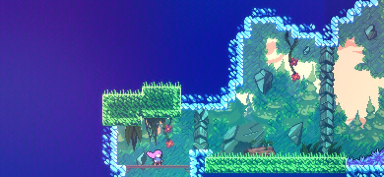 | 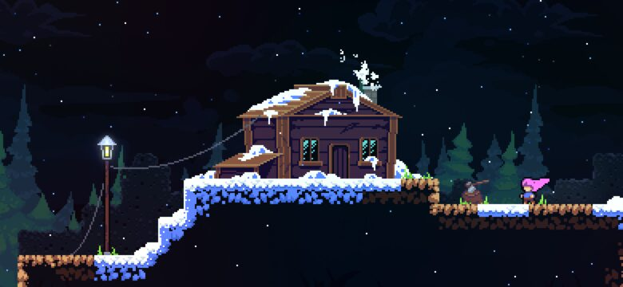 |
| 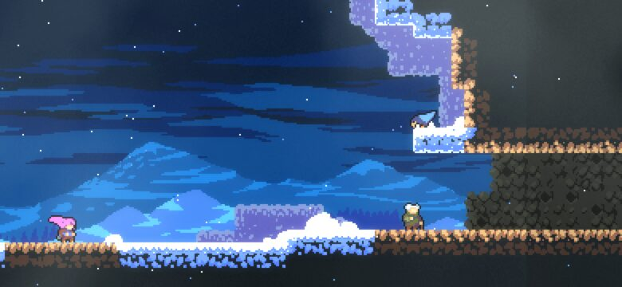 | 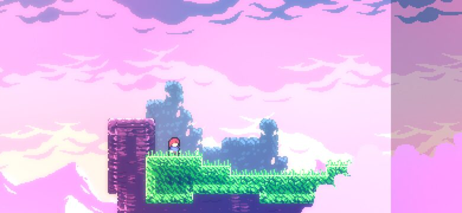 |

## Limitações conhecidas

- Capítulos 4 e 10: o fundo de nuvens tem uma emenda vertical perto da borda direita (em investigação).
- O HUD de canto (morangos, cronômetro) fica na borda da área 16:9 central, não na borda da tela.
- Cenas de corte com a câmera em posições fixas foram pensadas para 320 de largura: algumas mostram mais do cenário do que o planejado.
